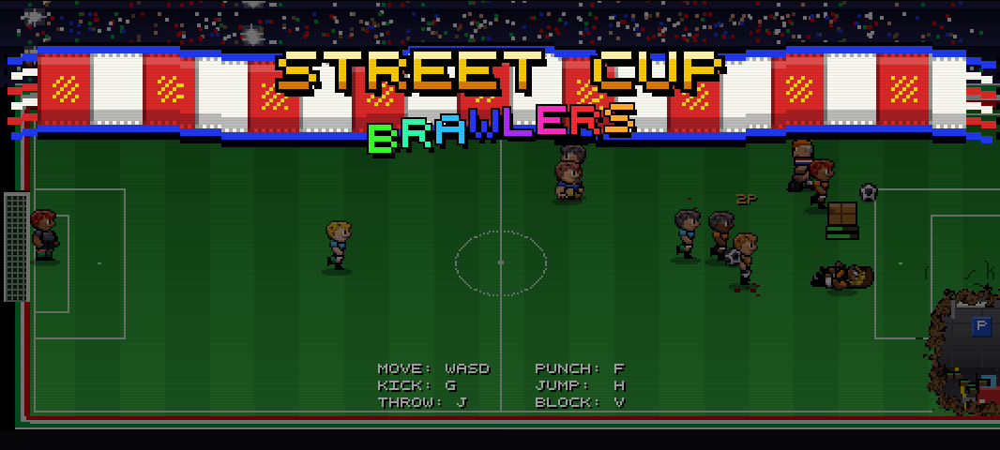
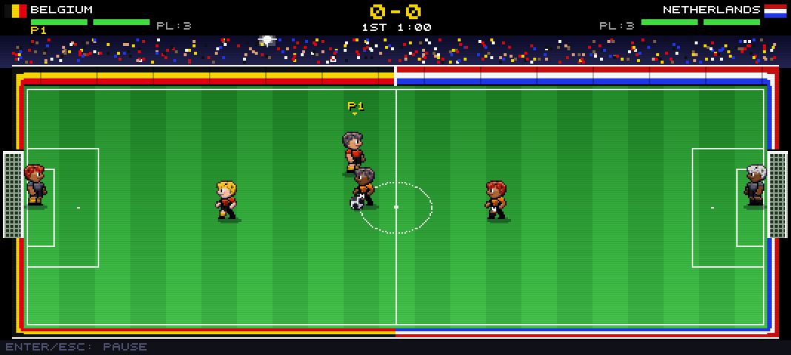
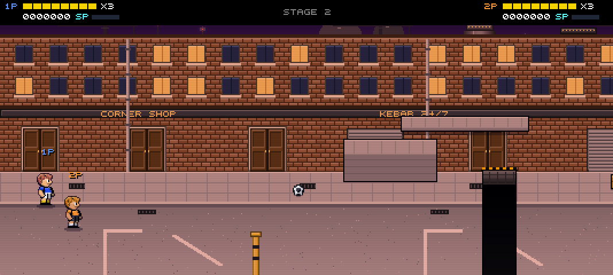

# Street Cup Brawlers

A retro NES-style mash-up of **Double Dragon** and **Nintendo World Cup**: soccer where fists are allowed, and a beat 'em up where the ball is your weapon.

The whole game is a single HTML file (`index.html`): pixel art, music and sound effects are all generated in code. There is nothing to install.

  
  &nbsp;
  

**Start game** opens the game right in your browser. **Install app** opens the same game with an install screen:
- Android: tap **INSTALL APP**.
- iPhone/iPad: follow the short Safari steps on screen (Share → Add to Home Screen).

## Modes

- **Story mode**: a beat 'em up for 1 or 2 players. You fight through 10 stages, from Main Street to the Stadium, plus a bonus stage on the Moon. It has pits, platforms, weapons, bosses and a super attack per fighter.
- **VS mode**: a soccer brawl. Play 1 vs 1 or 2 vs 2 against the computer, a friend, or in co-op. Each team has 3 players in reserve (PL:3).

| | |
|---|---|
|  |  |

## Controls

| Action | Player 1 | Player 2 | Gamepad |
|---|---|---|---|
| Move | W A S D | Arrow keys | Stick / D-pad |
| Punch | F | K | A |
| Kick | G | L | X |
| Jump | H | ; | B / Y |
| Throw item | J | O | LB / RB |
| Block | V | P | LT / RT |
| Super | F + G | K + L | |
| Run | double-tap a direction | | |
| Start / pause | Enter | | Start |

On a phone you get a joystick plus PUNCH, JUMP, BLOCK and KICK buttons. The game switches to landscape full screen automatically.

## Playing

- **On a computer:** open `index.html` in a browser.
- **Online (GitHub Pages):** go to *Settings → Pages* and set the source to *Deploy from a branch*, branch `main`, folder `/ (root)`. The game will then be at `https://koelcell.github.io/street-cup-brawlers/`.
- **As an app on your phone:** open the GitHub Pages link.
  - Android (Chrome): ⋮ → *Install app*.
  - iPhone (Safari): Share → *Add to Home Screen*.
  - It works offline after the first launch.

## Files

- `index.html`: the complete game.
- `manifest.webmanifest`, `sw.js`, `icon-*.png`: what makes the game installable as an app and playable offline.
- `screenshots/`: the development process in images, in chronological order.
